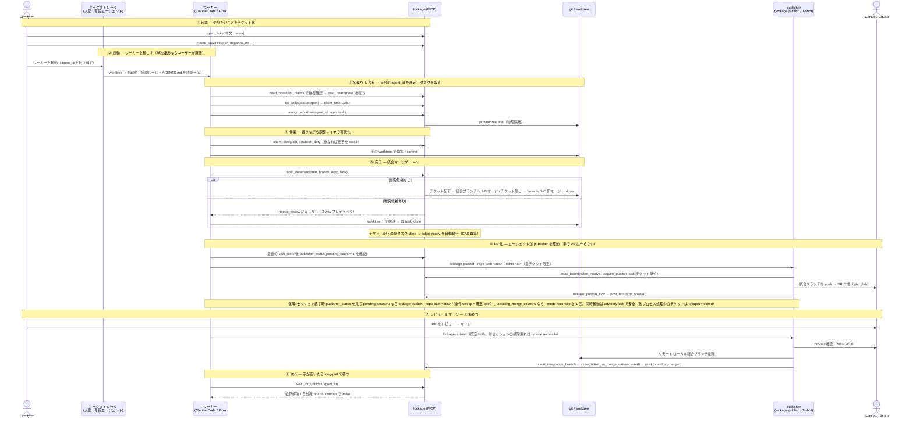

# lockage

> English: [README.md](README.md)

複数のコード開発 LLM（Kiro / Claude Code など）が、**ローカルの git リポジトリを中心に協調して開発する**ための MCP サーバです。

同じリポジトリに複数のエージェントを同時に走らせると、ふつうは「同じファイルを同時に書いて壊す」「誰がどこを触っているか分からない」「統合（マージ）がカオスになる」という問題が起きます。lockage は、これを **git worktree による物理隔離** と **SQLite 上の軽量な調整レイヤ** の組み合わせで解きます。

単一ホスト（個人の PC 1 台）での協調に向けたツールです。

> このドキュメントは lockage を使い始める人向けです。lockage 自体を開発・ビルド・テストする方法は [`docs/development.md`](docs/development_ja.md)、PR 化（`lockage-publish`）の運用の詳細は [`docs/publishing.md`](docs/publishing_ja.md) を参照してください。

---

## 何が特徴か

- **物理隔離（worktree）+ 論理的な可視化（claim / dirty set）の 2 階層**
  各エージェントを git worktree で物理的に分離し、「同じファイルを 2 人が同時に書く」こと自体を不可能にします。その上に「誰がどこを担当しているか」を宣言する advisory（助言的）な調整レイヤを重ねます。調整レイヤは **警告するだけでブロックしません**（warn-never-block）。デッドロックを生む hard lock は採用していません。

- **原子的なタスク占有（CAS）**
  タスクの claim は SQLite の `BEGIN IMMEDIATE` + バージョン CAS で直列化し、2 エージェントが同じタスクを取る競合を機械的に防ぎます（後発は `conflict` を受け取り、ブロックされません）。

- **統合マージゲート**
  worktree の成果を統合する経路を 1 本のゲートで直列化します。**チケット配下のタスクはタスク数に関わらず（1 つでも）直列マージゲート（1-B）を通してチケット統合ブランチ `lockage/ticket/<短縮ID>` へ集約**します。親チケットの無い軽微タスク（チケットに紐づかないタスク）で乖離が無いものだけ、その場で base ブランチへ即マージ（1-C）します（乖離・衝突候補があれば同じく直列ゲート 1-B を通します）。衝突候補は 3-way プレチェックで検出し、**自動解決せず差し戻して**人間／担当に委ねます。

- **A2A wake でポーリングを消す**
  他エージェントが自分の担当領域に踏み込んだ、依存タスクが完了した、自分宛の連絡が来た —— といったイベントを `wait_for_unblock` の 1 回の long-poll で待てます。エージェント側の空ポーリングが不要になります。

- **状態は SQLite が一次情報源**
  タスク・claim・worktree・board などの状態の一次情報源は SQLite です。既定の置き場はホームディレクトリの `~/.lockage/lockage.sqlite`（`LOCKAGE_DB` で変更可）です。

lockage は、原子 claim・依存 DAG・チケット管理・worktree 物理隔離・advisory claim/dirty set・統合マージゲート・board/A2A wake・blocked 中断ライフサイクルを提供する MCP サーバです。

---

## 必要環境

- **Node.js 22.5 以上**（SQLite は Node 標準の `node:sqlite` を使うため、ネイティブビルドや追加の DB は不要です）
- **git**（worktree / マージ操作に使用）

---

## セットアップ

clone も build も要りません。MCP クライアントの設定に、npm 公開物を `npx` で起動する定義を書くだけです（具体的な設定は下の「[MCP クライアントへの登録](#mcp-クライアントへの登録)」を参照）。

```json
{
  "mcpServers": {
    "lockage": { "command": "npx", "args": ["-y", "lockage"] }
  }
}
```

初回は取得に少し時間がかかることがあります。DB（台帳）は既定で `~/.lockage/lockage.sqlite` に作られるので、追加の設定は不要です。

使い始めに必要なのは **MCP クライアントへの登録** と、次節の **協調ルールの配布** の 2 つです。この 2 つをそろえれば、複数エージェントの協調が回り始めます。

### MCP クライアントへの登録

Kiro / Claude Code / Antigravity などの MCP 設定に、次のようなサーバ定義を追加します（設定ファイルの書式は各クライアントに従ってください。Antigravity は `~/.gemini/config/mcp_config.json` で、`agy mcp add` でも登録できます）。

Kiro の `mcp.json` には、npm 公開物を `npx` で起動する次の定義を追加します（clone や `npm run build` は要りません。初回は取得に少し時間がかかることがあります）。

```json
{
  "mcpServers": {
    "lockage": {
      "command": "npx",
      "args": ["-y", "lockage"],
      "disabled": false
    }
  }
}
```

DB（台帳）の保存先は既定で `~/.lockage/lockage.sqlite` が使われます（親ディレクトリは自動作成されます）。既定のままでよく、場所を変えたい人だけ `lockage` に `"env": { "LOCKAGE_DB": "/absolute/path/to/your-workspace/.lockage/lockage.sqlite" }` を足します。

複数のエージェントが協調する場合は、**同じ `LOCKAGE_DB` を指す**ように全員をそろえます。既定のまま使えば全員が同じ既定の台帳を指すので、追加の設定は要りません。これが共有の調整台帳になります。

Claude Code では、ここで登録する必要はありません。lockage プラグイン（次節）がこの `npx -y lockage` の定義を同梱しているので、プラグインを入れればサーバも登録されます。以前に手で登録していた場合は、サーバが 2 つ並ばないよう、その登録を外してください。登録の `env` に `LOCKAGE_DB` を書いていたなら、外す前に Claude Code の `settings.json` の `env` へ移します（スコープごとの手順は [`plugins/README.md`](plugins/README_ja.md#claude-code) を参照）。

Antigravity など、まだ npm 公開物での起動を確かめていないクライアントでは、clone して `npm run build` したうえで、`command:node`・`args:["/absolute/path/to/lockage/dist/index.js"]`・`env.LOCKAGE_DB` を指す従来の定義で登録します（Antigravity は `agy mcp add --env LOCKAGE_DB=<台帳の絶対パス> lockage node <lockage のリポジトリのパス>/dist/index.js`）。

エージェントの設定には `LOCKAGE_TOOLSETS` を書きません（既定の `core` だけが見えます）。保守・診断のツールを人間が使うときだけ、その MCP クライアントの `env` に `"LOCKAGE_TOOLSETS": "maintenance"` を足します。
Claude Code のプラグインでは同梱のサーバが `env` を持たないので、人間が使う場所にだけ保守用のサーバを別に登録し、使い終わったら外します。

```bash
claude mcp add lockage-maint -s local -e LOCKAGE_TOOLSETS=maintenance -- npx -y lockage@latest
claude mcp remove lockage-maint -s local
```

コマンドは同梱のもの（`npx -y lockage`）と変えてください（ここでは `lockage@latest`）。Claude Code は名前や `env` が違ってもコマンドが同じサーバを 1 つにまとめるので、`npx -y lockage` で登録すると同梱のサーバが置き換わり、lockage-worker がツールを見つけられなくなります（Claude Code 2.1.285 で確認）。

---

## 協調ルールの配布

MCP クライアントへの登録と、この協調ルールの配布の 2 つがそろえば使い始められます。前節で登録を書いたら、続けて各エージェントへ協調ルールを配ります。

**主経路は plugin / Power での導入です。** 導入先リポジトリには何も置かずに、クライアント側で協調ルールとフックを読み込めます。

- **Claude Code**: このリポジトリをマーケットプレイスとして登録し、lockage プラグイン（`plugins/claude`）を入れる。MCP サーバもプラグインが登録する。
- **Antigravity**: `agy plugin install <lockage をクローンしたローカルのパス>/plugins/antigravity` で入れる。
- **Kiro**: `plugins/kiro` を Power として登録し、導入先の `.kiro/hooks/` に hook を置く（`npx -y lockage setup kiro`）。

いずれも手順の詳細は [`plugins/README.md`](plugins/README_ja.md) を参照してください。

**plugin / Power を使えない環境向けの手導入**: 協調ルールの正本は [`plugins/shared/AGENTS.md`](plugins/shared/AGENTS.md) です。これを導入先プロジェクトのルートに `AGENTS.md` としてコピーすれば、同じ協調ルールを読ませられます（正本は 1 つに保ち、ここに全文は転記しません。二重管理を避けるためです）。

### なぜ配布が必要か

このサーバを MCP 設定に登録しただけでは、エージェントは「いつ・どのツールを・どの順で呼ぶか」を知りません。協調に必要な指示（`AGENTS.md` の協調ルールと lockage-workflow スキル）を各エージェントに届けて初めて、協調ルールのとおりに調整が回り始めます。

> 💡 複数のエージェントを協調させる前提は 2 つだけです。**(a)** 全員の MCP 設定が **同じ `LOCKAGE_DB` の絶対パス**を指していること、**(b)** 各エージェントが **自分だけの一意な `agent_id`** を名乗ること（共通 `AGENTS.md` では事前に書き分けられないので、各エージェントが起動時に自分で決め、board で重複を確認します）。この 2 つが揃えば、協調ルールのとおりに調整が回ります。

### 協調フローとツールの対応

協調ルール（`plugins/shared/AGENTS.md`）がどの場面でどの lockage ツールを呼ぶかの対応です。

| フロー | 呼ぶツール |
|---|---|
| タスク計画（依存を含む） | `create_task`（`depends_on`）/ `add_dependency` |
| タスクを探す・取る | `list_tasks(status:"open")` → `claim_task` |
| 自分の作業場所を得る | `assign_worktree`（返る `worktree_path`/`branch` で作業。移動できなければ `post_board` で依頼） |
| 変更予告・衝突検知 | `publish_dirty`（`overlaps` を見る） |
| 連絡・引き継ぎ | `post_board` / `read_board` |
| 完了できず中断・再開 | `post_board(kind:"question")` → `block_task` →（人間が続行なら）`resume_task` ／（別 worker 指名なら）`handoff_task` |
| 完了・統合 | `task_done`（`needs_review` なら戻り値の `contested` を見て解消 → 再 `task_done`） |
| PR 化（チケット単位・エージェント駆動） | `publisher_status` を見て `lockage-publish` を起動し自チケットを PR 化（手で `gh pr create` しない）。駆動タイミング・`--mode`・運用上の注意は [`docs/publishing.md`](docs/publishing_ja.md) を参照 |
| アイドル | `wait_for_unblock` |

---

## 優先度（priority）の決め方

タスク（`create_task`）とチケット（`open_ticket` / `update_ticket`）には `priority` を指定できます。処理順を決めるこの値には、次の一貫したルールを採用しています。

- **大きいほど優先**。`priority` は整数で、既定は `0`。値が大きいタスク／チケットほど先に選ばれます（`list_tasks` / `list_tickets` は `ORDER BY priority DESC` で返します）。
- **同一優先度のタイブレークは `created_at` 昇順**（＝古いものが先）。同じ優先度なら、先に作られたものから処理されます。
- **負値も使えます**。`0` が既定（通常）なので、明示的に後回しにしたいものは負値（例 `-10`）を付けます。上限・下限はありません。

### なぜ「大きいほど優先」か

このツールは MCP 経由で AI エージェントが `priority` を渡す前提です。「数字が大きい＝強い（優先される）」が最も直感に沿い、誤解が起きにくいためこの向きを採用しています（「`0` が最優先」方式だと、既定 `0` の新規タスクがすべて先頭に来てしまい、数字を上げると優先度が下がるという反直感が生じます）。

### 推奨レンジ（目安）

厳密な区分ではなく、値の付け方をそろえるための目安です。

| 値 | 意味 |
|---|---|
| `100` | 割り込み（最優先。他をすべて追い越したいとき） |
| `10` | 高 |
| `0` | 通常（既定） |
| `-10` | 低（明示的に後回し） |

---

## 提供ツール（37）

MCP ツールとして以下を公開しています。`agent_id` は各エージェントが名乗る識別子です（単一ホストの信頼境界内）。

### ツールの組（`LOCKAGE_TOOLSETS`）

既定では、エージェントが使う `core` のツール（28 個）だけを公開します。ほかの組は、サーバの起動時に環境変数 `LOCKAGE_TOOLSETS`（カンマ区切り）で有効にします。組に入るツールは、下の表の役割の欄に「組: …」と書いています。

| 組 | 有効にする方法 | ツール |
|---|---|---|
| core | 常に有効 | 下の表で「組」を書いていないもの |
| publisher | `lockage-publish` が自分で起動するサーバで有効にする（設定は不要） | `acquire_publish_lock` `release_publish_lock` `clear_integration_branch` `close_ticket_on_merge` `release_ticket_worktrees` `release_ticket_claims` |
| maintenance | 人間が保守・診断に使う MCP クライアントの `env` に `"LOCKAGE_TOOLSETS": "maintenance"` を書く | `reclaim_orphan_worktrees` `process_merge_queue` `list_merge_queue` |

`publisher` の組は、エージェントが呼ぶとチケットを閉じたり統合ブランチ名を消したりしうる後始末用なので、エージェントには見せません。

### タスク操作

| ツール | 役割 |
|---|---|
| `create_task` | タスクを作成（`ticket_id` は任意、`depends_on` で依存を張る。循環は拒否） |
| `add_dependency` | 既存タスク間に依存（blocks）を張る（`from_task` が `to_task` をブロック。循環は拒否） |
| `list_tasks` | タスク一覧（claim に渡す `version` 付き。`status`／`assignee`／`ticket_id`／`repo` で絞り込み。未割当のタスクは `status:"open"`。`ready_only` で依存解決済みのみ。`status:"blocked"` では孤児の判断材料として `blocked_age_sec`／`agent_silent_sec`／`last_question` を添える（自動回収はしない）） |
| `claim_task` | 原子的にタスクを占有（CAS。競合は `conflict` 返却でブロックしない） |
| `release_task` | タスクを解放（`outcome="open"` で再 claim 可能に／`"abandoned"` で放棄） |
| `block_task` | 人間判断待ちで中断（`in_progress`→`blocked`）。assignee／worktree を保持し、lease sweep の対象外＝無期限保持。詰まった理由は先に `post_board(kind="question")` で残す |
| `resume_task` | 人間が「続行」を指示したときの同一 agent 再開（`blocked`→`in_progress`）。別 worker へ回すのは handoff（人間明示時のみ） |
| `handoff_task` | `blocked` タスクを別 worker へ **worktree 単位で一括移管**（§4.7）。task／この task の active worktree／`holder=from` かつ `task_id` 一致の active claim／移管 worktree の dirty_set を同一 CAS トランザクションで `from`→`to` へ付け替える（branch／path は不変）。二重 handoff は `assignee=from` かつ `blocked` の CAS で防止。`in_progress` は横取り移管不可（必ず `blocked` にしてから）。別 worker 化は人間明示時のみ |
| `task_done` | 完了 → 統合マージゲートへ（1-C 即マージ / 1-B 直列ゲート）。マージ成功で `done` |
| `heartbeat` | 生存報告。保持中タスク／claim の lease を延長。あわせて割当中 worktree の git 状態から dirty を自動計算し、claim の glob 外は `unclaimed` として返す（§52） |

### チケット操作（課題のまとめ単位・モデル3）

チケットは横断・長命・claim されない課題のまとめ単位。`tasks.ticket_id` で 1 チケット → N タスクに紐づけます。

| ツール | 役割 |
|---|---|
| `open_ticket` | チケット起票（`repos` 省略／空 = 全横断。本文は FTS5 索引化） |
| `update_ticket` | チケット更新（`version-CAS`。競合は `conflict` 返却でブロックしない） |
| `list_tickets` | 一覧／検索（`priority` の降順、同じなら古い順。`status`／`repo`／`query` で FTS5 全文検索。`limit` の既定は 100 件。repo 指定時は全横断も含む） |
| `read_ticket` | チケット 1 件取得（`integration_branch`／`ticket_ready_at`／`repos` を含む。publisher 用） |
| `clear_integration_branch` | 組: publisher。`integration_branch` を NULL に戻す（PR マージ後クリーンアップ。system 列・version 不変・冪等） |
| `close_ticket_on_merge` | 組: publisher。PR マージ後にチケットを `closed` に倒す（reconcile 専用。`clear_integration_branch` と同じ思想で `update_ticket`（version-CAS）とは分離し version 不変。`status != closed` の局所 CAS で冪等・一方向） |
| `link_task_to_ticket` | タスクを親チケットに結び直す（`ticket_id=null` で解除） |

### ファイル協調（advisory）

| ツール | 役割 |
|---|---|
| `claim_files` | 担当領域を glob で宣言（重複は警告のみ、ブロックしない） |
| `release_claim` | claim の明示解放 |
| `list_claims` | 現在有効な claim 一覧 |
| `publish_dirty` | 変更済みファイルを公開し、重なる相手を A2A wake で起こす。明示公開に加え lockage が worktree の git 状態（`git status` ＋ `base_sha` からのコミット差分）から dirty を自動計算して和に含め、claim の glob 外は `unclaimed` として返す（§52。worktree ごと最小 30 秒間隔で間引く） |
| `list_dirty` | dirty set 一覧（明示 `publish_dirty` 分と、`heartbeat` 等で自動計算された worktree の git 由来の変更の和を表示） |

### 文脈共有（board）

| ツール | 役割 |
|---|---|
| `post_board` | 共有ボードへ投稿（`to_agent` 指定で有向 handoff） |
| `read_board` | ボード読取（`since` カーソルで差分取得。`unresolved_only:true` で解決済みの question を除く。未解決の question だけを見るときは `kind:"question"` と組み合わせる） |
| `resolve_question` | question を解決済みにする（自動解決の補完。task を done/abandoned にすると紐づく未解決 question は自動解決されるので、`ref_task_id` を持たない question や人間が回答だけして閉じたい question を明示的に閉じる用。冪等） |

### worktree

| ツール | 役割 |
|---|---|
| `assign_worktree` | git worktree を割り当て物理隔離（冪等再利用） |
| `release_worktree` | worktree 解放（既定でブランチは残す。remove 失敗時は released にせず active 維持し reason を返す） |
| `list_worktrees` | 有効な worktree 割当一覧（`agent_id`・`ticket_id` で絞り込み）。`stale:true` で、done タスクに紐づくのに active で残る worktree（＝解放に失敗した候補）だけを返す（読み取り専用） |
| `reclaim_orphan_worktrees` | 組: maintenance。孤児化した worktree を列挙/回収（dry_run で列挙のみ） |
| `release_ticket_worktrees` | 組: publisher。チケット配下の done タスク worktree をまとめて解放（reconcile の MERGED 経路から呼ぶ） |
| `release_ticket_claims` | 組: publisher。チケット配下の done／abandoned タスクに紐づく claim をまとめて解放（reconcile の MERGED 経路から呼ぶ。取り残しの回収経路） |

### マージゲート

| ツール | 役割 |
|---|---|
| `process_merge_queue` | 組: maintenance。直列マージゲートを駆動（通常は `task_done` が自動駆動。明示駆動用） |
| `list_merge_queue` | 組: maintenance。マージキュー一覧（`needs_review` 等で絞り込み） |
| `publisher_status` | 未処理の `ticket_ready`（PR 化待ち）件数・既存 PR の更新待ち件数・マージ待ち（`pr_opened` 済みだが `pr_merged` が無い＝reconcile 待ち）件数（`awaiting_merge_count`）・publisher の最終実行痕跡（`pr_opened`／`pr_merged` の時刻）・各チケット一覧を board から観測（読み取り専用。publish は起動しない）。3 つの件数は観測の別軸で排他ではない（特に更新待ちとマージ待ちは同一チケットが両方に出うるので単純合算しない） |

### publish ロック（チケット単位 advisory lock）

`lockage-publish` を複数プロセスが同時に起動しても同一チケットを二重処理しないための advisory lock です。`claims` の lease/TTL と同じ思想で、PK=`ticket_id` なので別チケットはブロックしません（既定 TTL 300 秒。クラッシュで解放できなくても TTL 失効で別プロセスが steal 可能）。通常は `lockage-publish` が内部で自動取得・解放するため、エージェントが直接呼ぶ必要はありません。

| ツール | 役割 |
|---|---|
| `acquire_publish_lock` | 組: publisher。チケット単位の publish advisory lock を取得（`ttl_sec` で TTL 指定可。既定 300。取得成功で `{ ok:true, holder }`、生きている lock があれば `{ ok:false }`。PK=`ticket_id` で別チケットはブロックしない） |
| `release_publish_lock` | 組: publisher。publish advisory lock を解放（`holder` 一致でのみ消す＝TTL 失効で steal された自分でない lock は消さない） |

### 待機（A2A wake）

| ツール | 役割 |
|---|---|
| `wait_for_unblock` | long-poll。「依存タスク ready / 自分宛か全体宛の board / overlap / timeout」のいずれかまでブロックし、理由（`woke_by`）を返す |

---

## 典型的な協調フロー

全体はチケット起点です。やりたいこと（課題・機能）をチケットとして起票し、それを複数のタスクに分割してエージェントが処理します。

1. `open_ticket(本文, repos)` でチケットを起票する（やりたいことのまとまり単位）。
2. `create_task(ticket_id, depends_on …)` で、そのチケットを 1 つ以上のタスクに分割する（`depends_on` で依存を張る）。
3. エージェントが各タスクを claim して処理する（下記「1 タスクの処理」）。
4. チケット配下のタスクは（1 つでも）各タスクの `task_done` が本流へ直マージせず、**チケット統合ブランチ `lockage/ticket/<短縮ID>` へ集約**される（タスク数による特別扱いは無い）。チケットに紐づかない軽微タスクのときだけ base ブランチへ直マージされる。
5. 同一チケット配下の全タスクが `done` になると `ticket_ready` が自動発行され（CAS で冪等）、publisher（`lockage-publish`）が統合ブランチを push → default ブランチへの PR 化する。

1 エージェントがタスクを 1 つ処理する流れ:

1. `list_tasks(status:"open")` で未割当タスクと `version` を取得
2. `claim_task(task_id, agent_id, expected_version)` で占有（競合したら別のタスクへ）
3. `assign_worktree(agent_id, repo_path, task_id)` で自分専用の worktree を得る
4. その worktree で作業しつつ、随時 `publish_dirty` で変更予定ファイルを公開（他者と重なれば相手が気づく）
5. 作業完了後、worktree 上でコミットしてから `task_done(agent_id, worktree_path, branch, repo, task_id)`
   - チケット配下のタスク（1 つでも）→ 衝突候補なしなら直列ゲート（1-B）経由でチケット統合ブランチへ集約
   - チケットに紐づかないタスク → 衝突候補なしなら base ブランチへ即マージ（1-C）
   - 衝突候補あり → `needs_review` に差し戻し。戻り値の `needs_review[].contested`（衝突しそうなファイル）を見て worktree 上で解決し、再度 `task_done`
6. 手が空いたら `wait_for_unblock(agent_id)` で次のイベント（依存解消・連絡・overlap）まで待機

---

## 利用想定フロー（ユーザー → エージェント → PR）

ユーザーが lockage をどう使うか、全体のライフサイクルをシーケンスで示します。登場人物は 5 つ:

- **ユーザー**（開発者）: やりたいこと（チケット）を投入し、PR をレビュー／マージする人間。
- **オーケストレータ**: 複数ワーカーを起こす調整役。人間でも、専任のエージェントでもよい（単独運用なら不在でよく、その場合ユーザーが直接ワーカーを 1 本起こす）。
- **ワーカー（エージェント）**: Claude Code / Kiro など。実際にコードを書く。複数本が並走する。
- **lockage**: MCP サーバ。SQLite を状態の一次情報源に、claim / worktree / board / マージゲートを提供。
- **publisher**: `lockage-publish`。`ticket_ready` を拾って統合ブランチを push し PR を作る 1-shot コマンド。常駐せず、**エージェント（または調整役）が叩いたときだけ 1 回走る**。主経路は「同一チケットの最後のタスクを `task_done` にしたエージェントが `publisher_status` を確認して `--ticket` 限定で起動」、保険は「各エージェントがセッション終了時に `publisher_status` を見て未処理が残っていれば全件 sweep で 1 回起動」。



**要点**:

- **人間が触るのは両端だけ**: 入口（`open_ticket` / `create_task`）と出口（PR のレビュー・マージ）。中間の claim → worktree → マージゲート → PR 化はエージェントと publisher が自動で回します。
- **エージェントは手で PR を作らない**: `task_done` まで回せば、全タスク done で `ticket_ready` が自動で立ちます。PR 化は `gh pr create` を自分で叩くのではなく、**最後のタスクを done にしたエージェントが `publisher_status` を見て `lockage-publish --ticket` を 1 回起動**して駆動します（保険としてセッション終了時に未処理があれば全件 sweep）。常駐ポーリングは不要で、複数エージェントが同時に起動してもチケット単位の advisory lock で二重処理されません（処理中のチケットは `skipped`＝`locked`）。
- **PR マージは人間の門**: 統合ブランチは自動で作られますが、本流への反映（PR マージ）はユーザーの承認を経ます（ブランチ保護 + マージ権限）。
- **単独運用**: オーケストレータが不要なら、ユーザーが任意の MCP クライアントでワーカーを 1 本起こすだけで同じフローが回ります。

PR 化はチケット単位で `lockage-publish`（別 bin）が担います。`ticket_ready`（チケット配下の全タスクが統合ブランチに集約済み）を拾って統合ブランチを push し、default ブランチへの PR を作る 1-shot コマンドです。コマンドの `--mode`・PATH 通し・エージェントが叩く駆動タイミング・運用上の注意の詳細は [`docs/publishing.md`](docs/publishing_ja.md) を参照してください。

---

## ライセンス

MIT License

参考にした既存プロジェクトは設計のアイデア（パターン）参照にとどめ、コードは流用していません。
