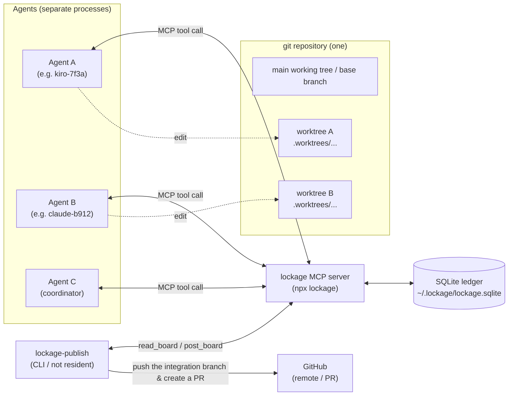
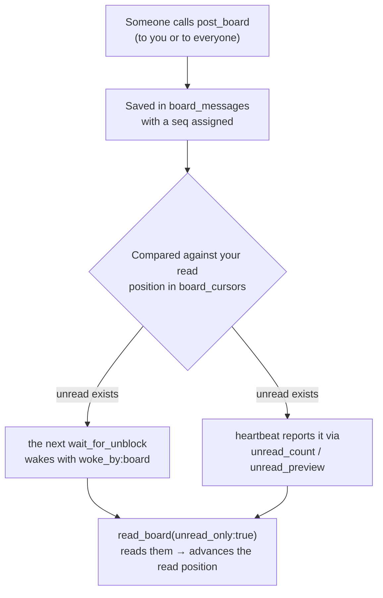
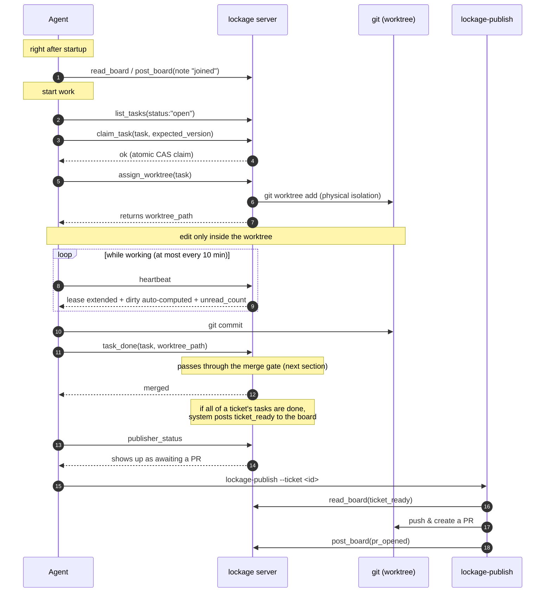
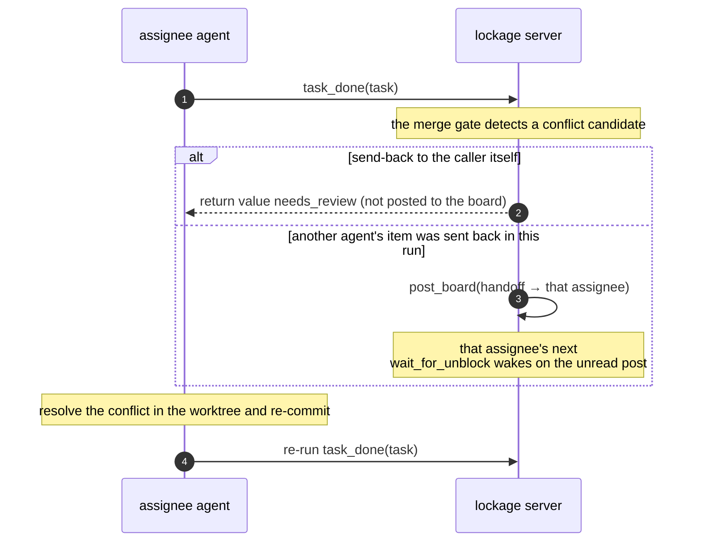
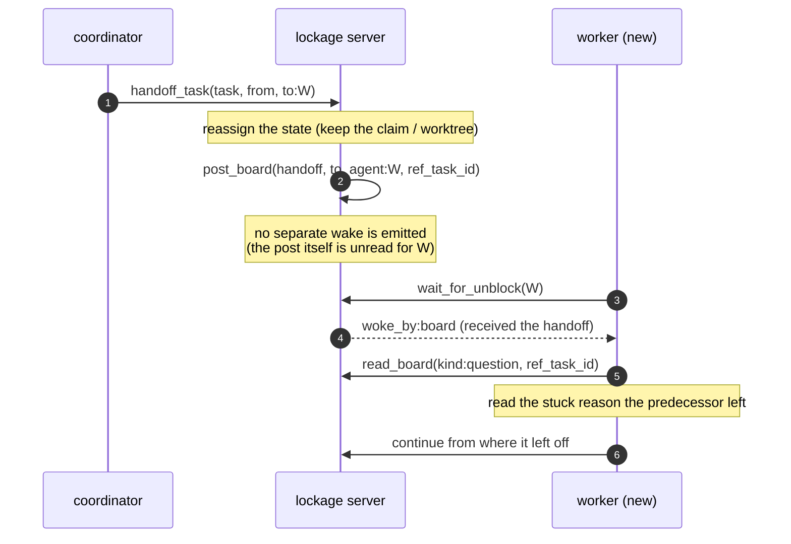
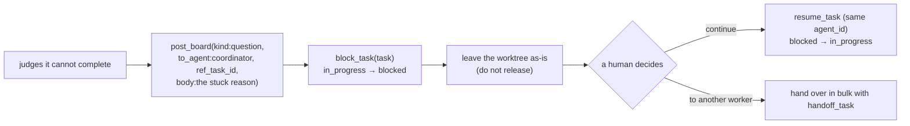
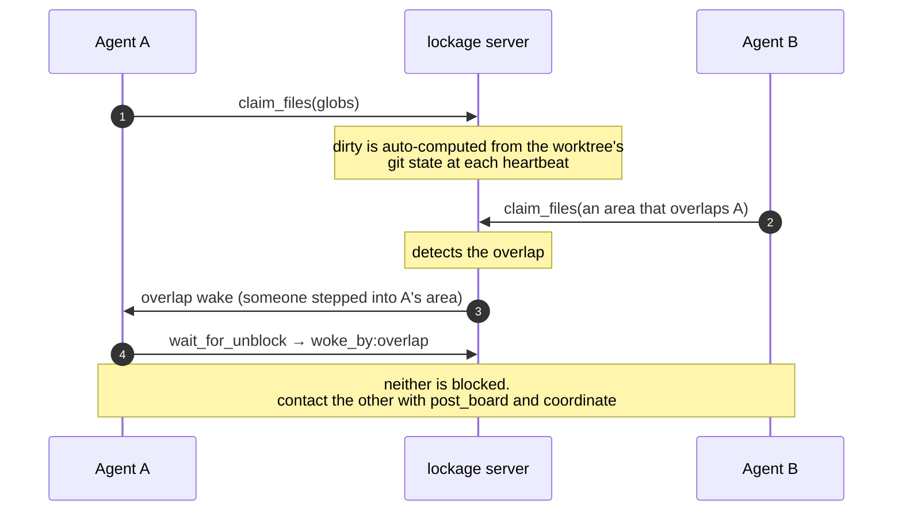
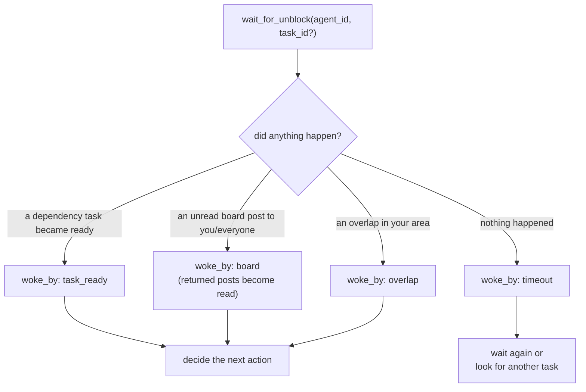

# lockage: system overview and the flow of messages between agents

> 日本語版: [overview_ja.md](overview_ja.md)

This document helps **people using** lockage picture how multiple agents collaborate, what messages they exchange, and how they make progress on a single repository without breaking it — all with diagrams to look at. It focuses on **use cases and the flow of information**, not the API spec of each feature.

- For how to get started, see [`README.md`](../README.md)
- For the detailed coordination procedure (the checklist for agents), see each plugin's `AGENTS.md` and the lockage-workflow skill
- For the operation of publishing PRs, see [`docs/publishing.md`](publishing.md)

---

## 1. The cast and where the data lives

lockage is an **MCP server** running on a single host. Multiple coding LLMs (agents) read and write state through this one server. The single source of truth for state is one SQLite file (by default `~/.lockage/lockage.sqlite`).



Key points:

- An agent edits **only inside its own worktree**. It does not touch the main working tree (the base branch) directly. This makes it physically impossible for two agents to write the same file at the same time.
- Agents never talk to each other directly. They exchange **nothing but asynchronous messages through the SQLite ledger**.
- `lockage-publish` is a non-resident CLI. It launches only at the stage of turning a ticket's work into a PR.

---

## 2. Kinds of messages

The "messages" exchanged between agents fall into two broad families.

### 2.1 board — persistent posts

Posts stacked in the `board_messages` table that do not disappear. You write them with `post_board` and read them with `read_board`. The purpose is split by `kind`.

| kind | who writes it | meaning | wakes the recipient? |
|---|---|---|---|
| `note` | agent | self-introduction / contact memo | wakes if unread |
| `question` | agent | the reason you are stuck / a question (tie it to the target task via `ref_task_id`) | wakes if unread |
| `handoff` | server / agent | task handoff notice (a needs_review send-back from system uses the same kind) | wakes if unread |
| `ticket_ready` | **server (system)** | all tasks under a ticket are done; it is ready to become a PR | does not wake (a record for PR publishing) |
| `pr_opened` / `pr_updated` / `pr_merged` | **lockage-publish** | records of the PR's state transitions | does not wake |

`ticket_ready` and `pr_*` are not "messages to an agent" but **records for the publisher (the PR-publishing process)**. These, and **your own posts**, do not count as unread.

### 2.2 wake — a signal that disappears

A transient signal that wakes `wait_for_unblock` (a single long-poll). Unlike the board, it does not stay on the board. `woke_by` tells you what woke you.

| woke_by | trigger |
|---|---|
| `task_ready` | a dependency task you were waiting on became done, and your task can now start |
| `board` | an **unread** board post addressed to you or to everyone arrived |
| `overlap` | another agent stepped into your area of responsibility (dirty / claim) |
| `timeout` | nothing happened and it timed out |

### 2.3 The read cursor

The "unread" state of the board is decided per agent with a **read position** held in the `board_cursors` table. Thanks to this, **you do not miss posts that arrived while you were not waiting (while you were working)**.



- The directed position (to you) starts **from seq 0**. A `handoff` that arrived before you launched is not missed.
- The broadcast position (to everyone) starts **from the latest seq at the moment you first touch the ledger**. Past posts to everyone do not flood in.
- Returned posts become read and are not returned again by the next `wait_for_unblock`. **The same notice never wakes you twice.**

---

## 3. The basic lifecycle (carrying one task through to the end)

The most basic flow of one agent processing a single task and turning it into a PR.



What matters is the single one-way road: **claim → isolate (worktree) → work → integrate (task_done) → publish**. A claim is serialized by SQLite's `BEGIN IMMEDIATE` + a version CAS, so a race between two agents taking the same task just leaves the loser receiving `conflict` — no blocking occurs.

---

## 4. The integration merge gate

When you call `task_done`, the worktree's work passes through **a single merge gate** to be integrated. If a conflict is likely, it is sent back instead of auto-resolved.

```mermaid
flowchart TD
    TD["task_done"] --> ENQ["enqueue into merge_queue"]
    ENQ --> GATE{"3-way precheck<br/>(main's changes ∩ my dirty)"}
    GATE -->|no conflict| TICKET{"has a ticket_id?"}
    GATE -->|conflict candidate| NR["send back as needs_review<br/>(task stays in_progress)"]
    TICKET -->|yes (even one)| IB["to the ticket integration branch<br/>lockage/ticket/&lt;short id&gt; (1-B)"]
    TICKET -->|no (a minor task)| SMALL{"has base not advanced<br/>past the branch point?"}
    SMALL -->|yes (no divergence)| BASE["merge straight to the base branch (1-C)"]
    SMALL -->|no (diverged)| IB
    IB --> DONE["set the task to done"]
    BASE --> DONE
    DONE --> READY{"all of the ticket's tasks done?"}
    READY -->|yes| TR["system posts ticket_ready to the board"]
    DONE --> WAKE["a task_ready wake to the assignees of<br/>downstream tasks this one was blocking"]
```

An immediate merge (1-C) happens only for a minor task with no ticket_id **and** when base has not advanced past the branch point (no divergence). If base has advanced, or the 3-way precheck turns up conflict candidates, it goes through the same serial gate (the 1-B mechanism) as tasks under a ticket before merging to base.

### 4.1 The send-back (needs_review) notice

When a conflict candidate is found, the assignee of that task is told of the send-back via a `handoff` post. The notice is a single post, so it never wakes twice with the same content. Furthermore, a send-back to the one who called `task_done` is **returned in the call's return value**, so it is not also double-posted to the board.



### 4.2 The dependency-resolution notice (task_ready)

When a task becomes done, a `task_ready` wake flies to the assignees of downstream tasks that were waiting on it via `depends_on`. The downstream assignee's `wait_for_unblock` wakes with `woke_by:"task_ready"` and can start right away.

---

## 5. Handoff and interruption

### 5.1 handoff (passing to another agent)

The flow when a human (the coordinator) decides "pass this task to another worker." The receiving side does not miss even a `handoff` that arrived before it launched, because **the directed position counts from seq 0**.



### 5.2 Interruption (blocked) — do not vanish silently

When a worker judges it cannot complete a task — for lack of permission, waiting on a design decision, and so on — it **does not exit silently**; it leaves the reason on the ledger before interrupting.



Leaving the reason first as a `question` is the crucial part. Skip it, and the lease expires after 15 minutes and the task returns to `open`, so **both the stuck reason and the worktree's partial progress are lost**.

---

## 6. File coordination (claim / dirty) — it warns but does not block

On top of physical isolation by worktree, an **advisory** layer where agents declare "who is touching what" is layered. This **only warns; it never blocks** (warn-never-block). No hard lock that could cause deadlock is used.



Besides extending the lease, `heartbeat` auto-computes the worktree's changes (dirty) and returns `overlaps` if they overlap another agent's dirty / claims, and files that moved outside the claim glob as `unclaimed`.

---

## 7. The unified picture of waiting (wait_for_unblock)

All the signals so far are gathered into a single long-poll of `wait_for_unblock`. No empty polling on the agent side is needed.



When idle, call `wait_for_unblock` once before looking for the next job. The trick is not to keep hitting the ledger with an empty `list_tasks` loop.

---

## 8. Summary

| Feature | tools used | messages exchanged |
|---|---|---|
| Joining / contact | `post_board` / `read_board` | board `note` |
| Task claim | `list_tasks` / `claim_task` | (CAS claim; no board) |
| Physical isolation | `assign_worktree` | (worktree creation; no board) |
| Liveness / dirty detection | `heartbeat` | `overlap` wake / unread count |
| Integration | `task_done` | `handoff` (send-back) / `task_ready` wake |
| Handoff | `handoff_task` | board `handoff` |
| Interruption | `block_task` + `question` | board `question` |
| Resolving a question | `resolve_question` (or automatically on task done) | — |
| Waiting | `wait_for_unblock` | `task_ready` / `board` / `overlap` / `timeout` wake |
| PR publishing | `lockage-publish` (CLI) | board `ticket_ready` / `pr_opened` / `pr_updated` / `pr_merged` |

The design that runs through the whole:

- **Two layers: physical isolation (worktree) + logical visibility (claim/dirty).** The coordination layer only warns; it never blocks.
- **The single source of truth for state is one SQLite file.** Agents do not talk directly; they exchange asynchronous messages through the ledger.
- **The board is managed with a per-agent read cursor.** You do not miss posts that arrived while working, and the same notice never wakes you twice.
