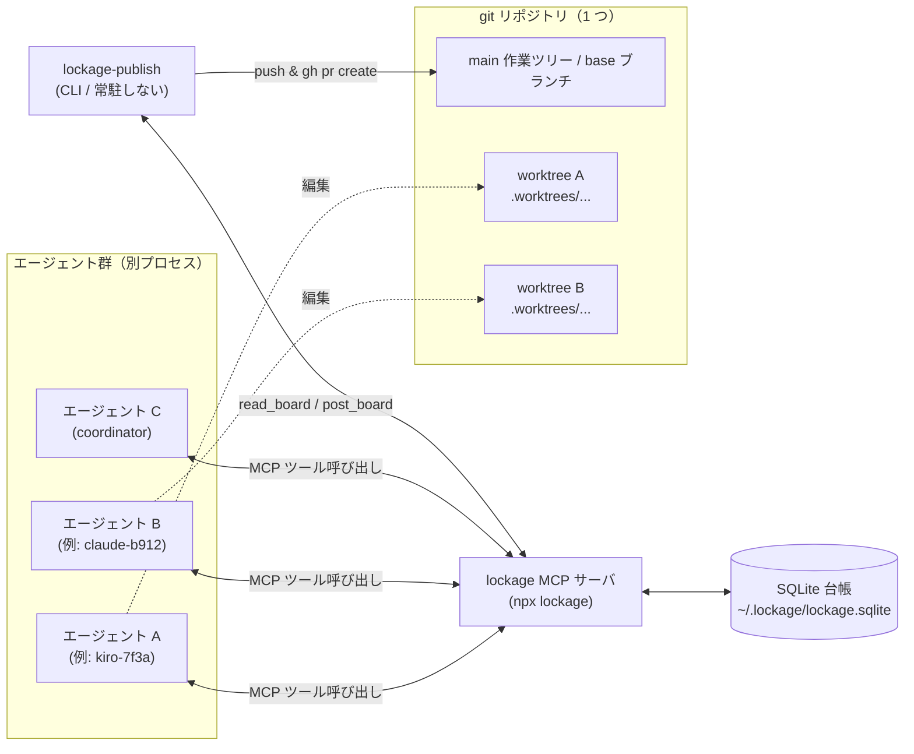
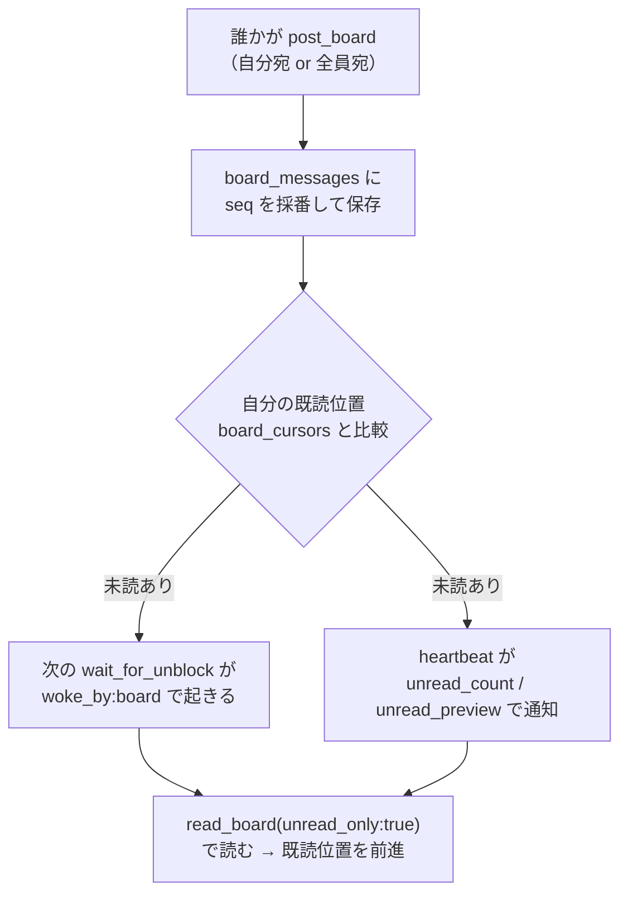
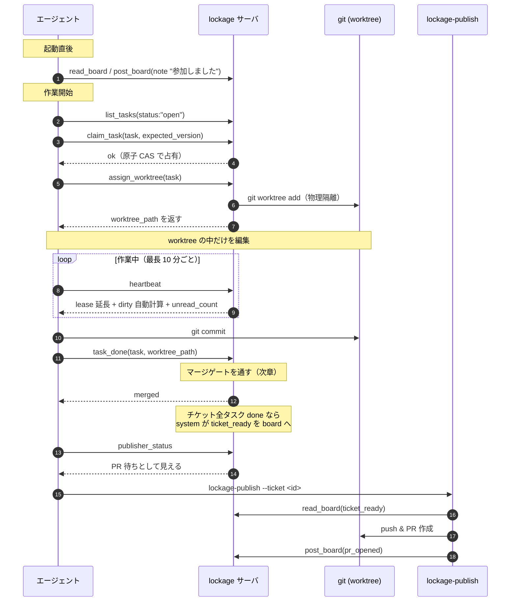
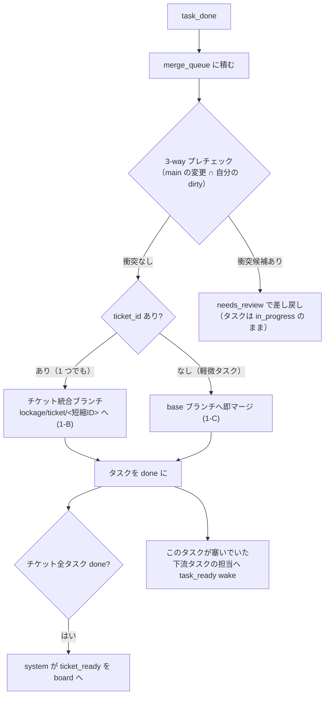
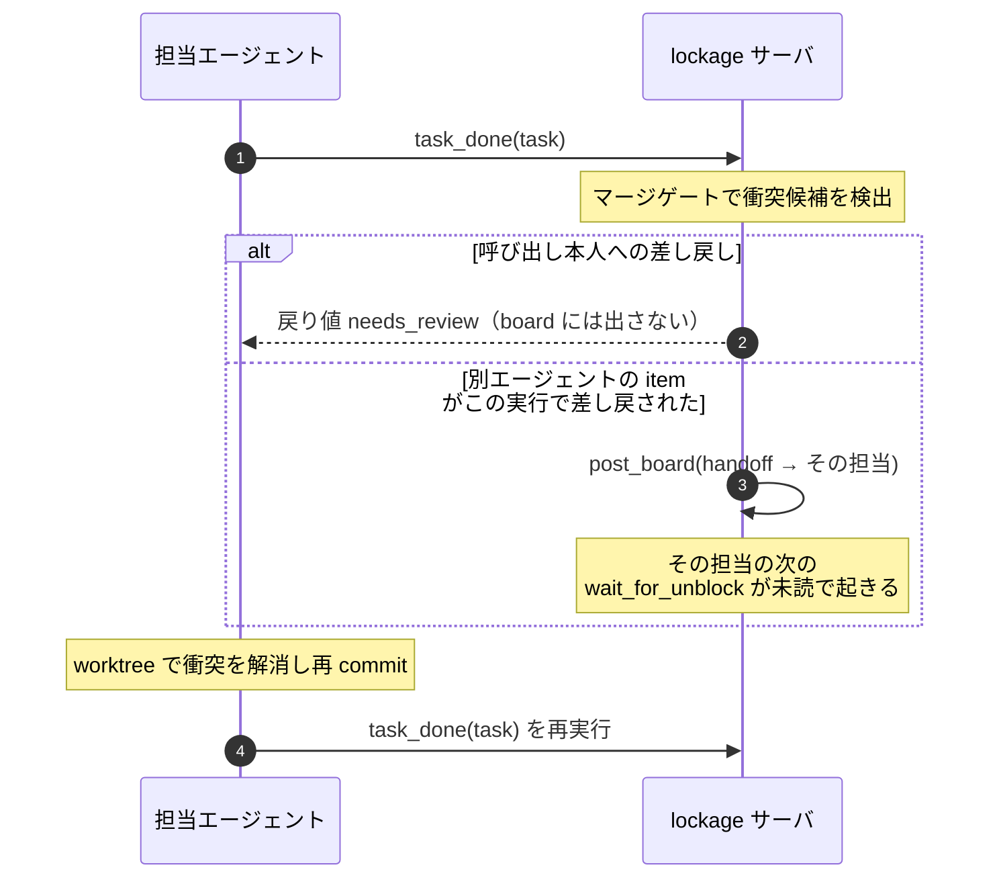
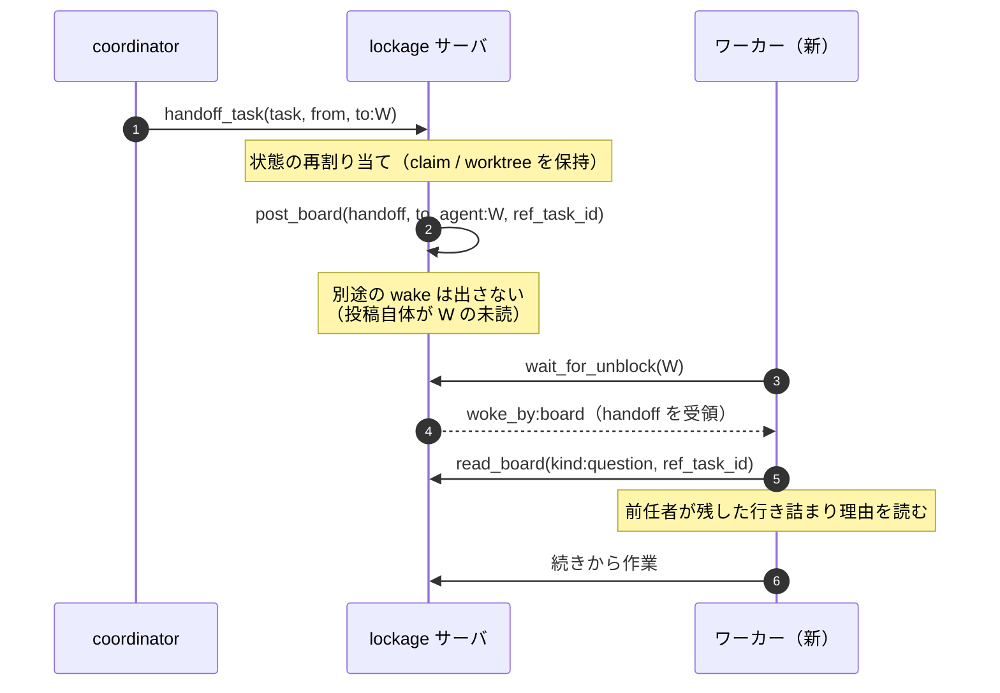
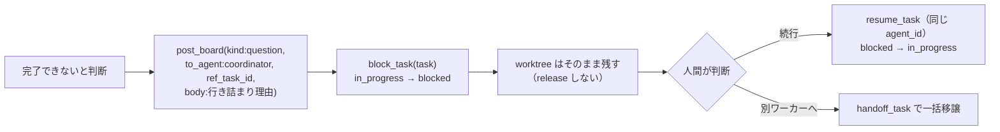
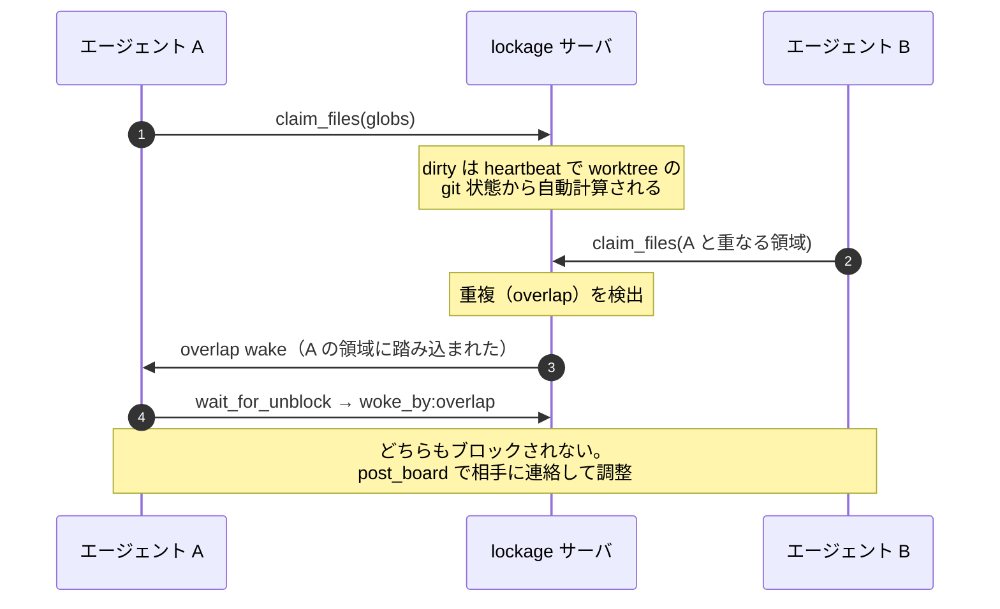
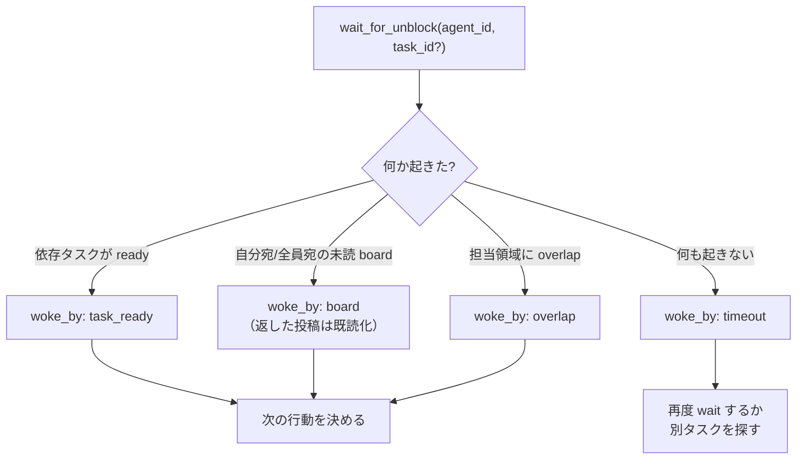

# lockage の全体像とエージェント間メッセージの流れ

> English: （未作成）

このドキュメントは、lockage を **使う人** が「複数のエージェントがどう協調し、どんなメッセージをやり取りして 1 つのリポジトリを壊さずに開発を進めるのか」を、図を見ながらイメージできるようにまとめたものです。各機能の API 仕様ではなく、**ユースケースと情報の流れ** に焦点を当てています。

- 使い始め方は [`README_ja.md`](../README_ja.md)
- 詳細な協調手順（エージェント向けチェックリスト）は各プラグインの `AGENTS.md` と lockage-workflow スキル
- PR 化の運用は [`docs/publishing_ja.md`](publishing_ja.md)

---

## 1. 登場人物とデータの置き場

lockage は、1 台のホスト上で動く **MCP サーバ** です。複数のコーディング LLM（エージェント）が、この 1 つのサーバを通して状態を読み書きします。状態の一次情報源は SQLite 1 ファイル（既定 `~/.lockage/lockage.sqlite`）です。

ポイント:

- エージェントは **自分専用の worktree の中だけ** を編集します。main 作業ツリー（base ブランチ）は直接触りません。これで「同じファイルを 2 人が同時に書く」ことが物理的に起きません。
- エージェント同士は直接通信しません。**すべて SQLite 台帳を介した非同期メッセージ** でやり取りします。
- `lockage-publish` は常駐しない CLI です。チケットの成果を PR 化する段でだけ起動します。

---

## 2. メッセージの種類

エージェント間でやり取りされる「メッセージ」は、大きく 2 系統あります。

### 2.1 board（掲示板）— 永続する投稿

`board_messages` テーブルに積まれる、消えない投稿です。`post_board` で書き、`read_board` で読みます。`kind` で用途が分かれます。

| kind | 誰が書く | 意味 | 相手を起こす? |
|---|---|---|---|
| `note` | エージェント | 自己紹介・連絡メモ | 未読なら起こす |
| `question` | エージェント | 行き詰まりの理由・質問（`ref_task_id` で対象タスクに紐付け） | 未読なら起こす |
| `handoff` | サーバ / エージェント | タスクの引き継ぎ通知 | 未読なら起こす |
| `ticket_ready` | **サーバ（system）** | チケット配下の全タスクが done。PR 化の準備ができた | 起こさない（PR 化の記録） |
| `pr_opened` / `pr_updated` / `pr_merged` | **lockage-publish** | PR の状態遷移の記録 | 起こさない |

`ticket_ready` と `pr_*` は「エージェントへのメッセージ」ではなく **publisher（PR 化処理）向けの記録** です。これらと **自分自身の投稿** は未読に数えません。

### 2.2 wake — 消える即時シグナル

`wait_for_unblock`（1 回の long-poll）を起こすための一時的なシグナルです。board と違って掲示板には残りません。`woke_by` で何に起こされたかが分かります。

| woke_by | きっかけ |
|---|---|
| `task_ready` | 待っていた依存タスクが done になり、自分のタスクが着手可能になった |
| `board` | 自分宛／全員宛の **未読** board 投稿が届いた |
| `overlap` | 他エージェントが自分の担当領域（dirty / claim）に踏み込んだ |
| `timeout` | 何も起きずにタイムアウト |

### 2.3 既読カーソル

board の「未読」は、エージェントごとに `board_cursors` テーブルで **既読位置** を持って判定します。これにより、**待機していない間（作業中）に届いた投稿も取りこぼしません**。

- 自分宛（directed）は **seq 0 から** 数えます。起動前に届いた `handoff` も取りこぼしません。
- 全員宛（broadcast）は **初めて台帳に触れた時点の最新 seq から** 数えます。過去の全員宛投稿が洪水のように流れ込みません。
- 返した投稿は既読になり、次回の `wait_for_unblock` では返りません。**同じ通知で二重に起きることがありません。**

---

## 3. 基本のライフサイクル（1 タスクを最後までやり切る）

1 人のエージェントがタスクを 1 つ処理して PR 化するまでの、最も基本的な流れです。

重要なのは、**占有（claim）→ 隔離（worktree）→ 作業 → 統合（task_done）→ PR 化（publish）** という一本道です。占有は SQLite の `BEGIN IMMEDIATE` + バージョン CAS で直列化され、2 エージェントが同じタスクを取る競合は後発が `conflict` を受け取るだけで、ブロックは起きません。

---

## 4. 統合マージゲート

`task_done` を呼ぶと、worktree の成果が **1 本のマージゲート** を通って統合されます。衝突候補があれば自動解決せず差し戻します。

### 4.1 差し戻し（needs_review）の通知

衝突候補が見つかると、該当タスクの担当へ `handoff` 投稿で差し戻しを知らせます。通知は投稿 1 本だけで、同じ内容で二重に起きることはありません。さらに、`task_done` を呼んだ本人への差し戻しは、呼び出しの **戻り値で返る** ため board には二重投稿しません。

### 4.2 依存解決の通知（task_ready）

あるタスクが done になると、それを `depends_on` で待っていた下流タスクの担当に `task_ready` wake が飛びます。下流の担当は `wait_for_unblock` が `woke_by:"task_ready"` で起き、すぐ着手できます。

---

## 5. 引き継ぎと中断

### 5.1 handoff（別のエージェントへ渡す）

人間（coordinator）が「このタスクを別のワーカーに渡す」と判断したときの流れです。渡された側は、起動前に届いた `handoff` でも **自分宛は seq 0 から未読扱い** なので取りこぼしません。

### 5.2 中断（blocked）— 黙って消えない

ワーカーが「権限不足・設計判断待ち」などで完了できないと判断したら、**黙って終了せず** 台帳に理由を残してから中断します。

理由を先に `question` として残すのが肝心です。これを飛ばすと、lease が 15 分で切れてタスクが `open` に戻り、**行き詰まりの理由も worktree の途中経過も失われます**。

---

## 6. ファイル調整（claim / dirty）— 警告はするがブロックしない

worktree で物理隔離した上に、「誰がどこを触っているか」を宣言する **advisory（助言的）** なレイヤを重ねます。これは **警告するだけでブロックしません**（warn-never-block）。デッドロックを生む hard lock は使いません。

`heartbeat` は lease 延長に加えて、worktree の変更（dirty）を自動計算し、他エージェントの dirty / claim と重なれば `overlaps`、claim glob の外に出たファイルは `unclaimed` として返します。

---

## 7. 待ち合わせの統合イメージ（wait_for_unblock）

ここまでのシグナルは、すべて `wait_for_unblock` の 1 回の long-poll に集約されます。エージェント側の空ポーリングは不要です。

アイドル時は、次の仕事を探す前にまず `wait_for_unblock` を 1 回呼びます。`list_tasks` の空ループで台帳を叩き続けないのがコツです。

---

## 8. まとめ

| 機能 | 使うツール | やり取りされるメッセージ |
|---|---|---|
| 参加・連絡 | `post_board` / `read_board` | board `note` |
| タスク占有 | `list_tasks` / `claim_task` | （CAS 占有。board なし） |
| 物理隔離 | `assign_worktree` | （worktree 作成。board なし） |
| 生存通知・dirty 検出 | `heartbeat` | `overlap` wake / 未読件数 |
| 統合 | `task_done` | `handoff`（差し戻し）/ `task_ready` wake |
| 引き継ぎ | `handoff_task` | board `handoff` |
| 中断 | `block_task` + `question` | board `question` |
| 質問の解決 | `resolve_question`（または task done で自動） | — |
| 待ち合わせ | `wait_for_unblock` | `task_ready` / `board` / `overlap` / `timeout` wake |
| PR 化 | `lockage-publish`（CLI） | board `ticket_ready` / `pr_opened` / `pr_updated` / `pr_merged` |

全体を貫く設計:

- **物理隔離（worktree）+ 論理可視化（claim/dirty）の 2 階層。** 調整レイヤは警告するだけでブロックしない。
- **状態の一次情報源は SQLite 1 ファイル。** エージェントは直接通信せず、台帳を介した非同期メッセージでやり取りする。
- **board はエージェントごとの既読カーソルで管理。** 作業中に届いた投稿も取りこぼさず、同じ通知で二重に起きない。
